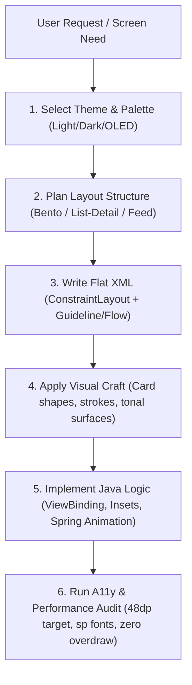

# Android UI/UX Master Skill (Java & XML Edition)

> **Mission**: Empower AI and Android developers to design and craft Android apps that look as stunning, modern, and fluid as top-tier Dribbble/Behance showcases while meeting production-level Material Design 3 guidelines, zero-jank 60/120fps performance, and strict WCAG 2.2 accessibility standards.

---

## 1. Core Architecture & Mental Model

Modern Android UI design is not just about placing buttons; it is a synthesis of three pillars:

```
┌────────────────────────────────────────────────────────────────────────┐
│                        ANDROID UI/UX TRIAD                             │
├─────────────────────────┬───────────────────────┬──────────────────────┤
│ 1. VISUAL CRAFT         │ 2. MATERIAL 3 SYSTEM  │ 3. TECHNICAL UX      │
│ (Dribbble-Level Appeal) │ (Google Standards)    │ (Performance & A11y) │
├─────────────────────────┼───────────────────────┼──────────────────────┤
│ • Bento grid cards      │ • 29+ Tonal color roles│ • 48×48dp hit targets│
│ • Frosted glass/blur    │ • 8dp spacing grid    │ • Edge-to-edge insets│
│ • Subtle mesh gradients │ • Shape scale (4-48dp)│ • SP font scaling    │
│ • Layered inner borders │ • Dynamic Color ready │ • Zero layout nesting│
│ • Spring physics & morph│ • Adaptive layouts    │ • Hardware layer GPU │
└─────────────────────────┴───────────────────────┴──────────────────────┘
```

---

## 2. Directory & Rule Reference Guide

This skill is organized into granular, authoritative rulebooks located in `rules/` and turnkey XML templates in `templates/`:

1. **Tokens & Theming** (`rules/01-material3-tokens-theming.md`):
   - 29 Tonal color roles (Light, Dark, and OLED Dark).
   - Tonal palette stops (0 to 100).
   - Defining and overriding `Theme.Material3.DayNight.NoActionBar` in XML.
   - Dynamic Color integration in Java (`DynamicColors.applyToActivitiesIfAvailable`).

2. **XML Layouts & Hierarchy** (`rules/02-xml-layouts-hierarchy.md`):
   - ConstraintLayout 2.1+ mastery: `Guideline`, `Barrier`, `Flow`, and `ConstraintSet`.
   - Eliminating nested weights and multiple measure passes.
   - Fast inflation using `ViewStub` and `merge`/`include`.

3. **Modern Dribbble-Style Patterns** (`rules/03-dribbble-modern-patterns.md`):
   - Mobile Bento Grids (asymmetric card grouping with visual hierarchy).
   - Glassmorphism & Translucency (`RenderEffect`, `Toolkit`, and fallback drawables).
   - Floating Navigation Bars, Modern Pills, and Gradient Highlights.
   - Layered strokes (`strokeWidth="1dp"` + `outline-variant`) for high-end depth.

4. **Component Craftsmanship** (`rules/04-components-craftsmanship.md`):
   - `MaterialCardView` with custom shape appearances and tonal backgrounds.
   - `ExtendedFloatingActionButton`, Floating Pill Menus, and Filter Chips.
   - Modern BottomSheets (rounded 28dp corners, drag handles, edge-to-edge keyboard padding).
   - Modern `TextInputLayout` and reactive validation states.

5. **Motion, Haptics & Micro-Interactions** (`rules/05-motion-microinteractions.md`):
   - Spring physics via AndroidX `SpringAnimation` and `DynamicAnimation`.
   - Touch feedback: Pressed scale reduction (`scaleX(0.97f)`) + masked ripples.
   - Smooth property animations with `ViewPropertyAnimator` and `FastOutSlowInInterpolator`.
   - Window and Fragment transitions.

6. **Accessibility, Insets & Ergonomics** (`rules/06-accessibility-ux-rules.md`):
   - WCAG 2.2 contrast rules (4.5:1 text, 3:1 controls).
   - Mandatory minimum 48×48dp touch targets with `TouchDelegate` for compact icons.
   - Android 15 Edge-to-Edge: `WindowCompat.setDecorFitsSystemWindows(window, false)` and `ViewCompat.setOnApplyWindowInsetsListener`.
   - Anti-patterns: What NEVER to do in Android XML and Java.

7. **Java Implementation & Architecture** (`rules/07-java-implementation-guide.md`):
   - Java ViewBinding best practices (leak-free binding lifecycle).
   - Programmatic styling using `ShapeAppearanceModel.builder()`.
   - Custom state listeners and reactive UI binding without bloat.

---

## 3. Quick Decision Workflow for Agents

When tasked with creating or redesigning an Android screen:



---

## 4. The 5 Golden Commandments of this Skill

1. **Never Nest Layouts When ConstraintLayout Can Do It Flatter**: Replace nested `LinearLayouts` with `ConstraintLayout` and `androidx.constraintlayout.helper.widget.Flow`.
2. **Never Hardcode Dimension Pixels or Colors**: Always reference `@dimen/` and `?attr/color*` or `@color/`.
3. **Always Guarantee 48×48dp Touch Targets**: If an icon is 24dp, its clickable container or `minWidth`/`minHeight` must be at least 48dp.
4. **Always Handle System Insets (Edge-to-Edge)**: Ensure app content never hides under the status bar, gesture navigation bar, or virtual keyboard.
5. **Always Use `sp` for Text and `dp` for Layout**: Never disable system font scaling.
