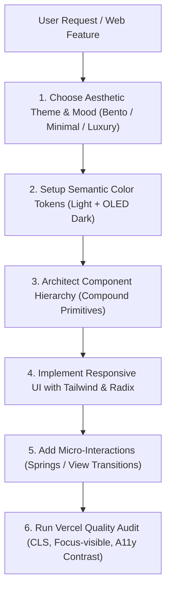

# Web UI/UX Master Skill (React & Modern Web Edition)

> **Mission**: Enable AI agents and React engineers to craft web applications that look visually breathtaking like award-winning Dribbble/Awwwards showcases, while executing with the uncompromising code quality, zero-CLS performance, and accessibility standards of Vercel Engineering.

---

## 1. Core Architecture & Mental Model

Modern web interfaces fail when they sacrifice engineering for aesthetics (broken contrast, janky animations, layout shifts) or sacrifice aesthetics for engineering (sterile, cookie-cutter "AI slop" SaaS cards). This skill unifies both:

```
┌────────────────────────────────────────────────────────────────────────┐
│                          WEB UI/UX MASTER TRIAD                        │
├─────────────────────────┬───────────────────────┬──────────────────────┤
│ 1. VISUAL SPLENDOR      │ 2. VERCEL ENGINEERING │ 3. WCAG 2.2 & UX     │
│ (Dribbble/Awwwards)     │ (React & Architecture)│ (Human Usability)    │
├─────────────────────────┼───────────────────────┼──────────────────────┤
│ • Asymmetric Bento Grids│ • Compound Components │ • Visible focus-ring │
│ • Frosted Glassmorphism │ • Zero CLS (CLS < 0.1)│ • Unblocked paste    │
│ • Deep OLED dark mode   │ • React 19 / Canary   │ • Tabular figures    │
│ • Ambient Aurora glows  │ • View Transitions    │ • 44px touch targets │
│ • Anti-AI Slop identity │ • No boolean prop hell│ • Accessible forms   │
└─────────────────────────┴───────────────────────┴──────────────────────┘
```

---

## 2. Directory & Rule Reference Guide

This skill is organized into granular rulebooks in `rules/` and turnkey React/Tailwind templates in `templates/`:

1. **Dribbble Aesthetic Systems** (`rules/01-dribbble-aesthetic-systems.md`):
   - Asymmetric Bento Grid patterns with dynamic visual rhythm.
   - Glassmorphism & Frosted Glass (`backdrop-blur`, layered hairline borders).
   - Modern Dark Mode & Deep Space Palette (no inverted grays).
   - Strict Anti-AI Slop guidelines (banning generic SaaS card kits and purple gradients).

2. **Vercel Engineering & Performance UX** (`rules/02-vercel-engineering-ux.md`):
   - 100+ audit rules for web quality and zero Cumulative Layout Shift (CLS).
   - Tabular numbers (`tabular-nums`) for currency and metrics.
   - Defensive content handling (`truncate`, `min-w-0`, `line-clamp`).
   - URL-first state management (deep-linkable modals and tabs).

3. **React Architecture & Composition** (`rules/03-react-composition-patterns.md`):
   - Eliminating boolean prop proliferation through Compound Components.
   - Standardized context interface: `{ state, actions, meta }`.
   - Modern React 19 standards (`use()`, first-class `ref` prop).

4. **Tailwind CSS & shadcn/ui Mastery** (`rules/04-tailwind-shadcn-mastery.md`):
   - Three-layer semantic design token model (`--color-background`, `--color-primary`, etc.).
   - Radix UI primitive integration with customized styling.
   - Custom utility classes for glow, glass, and interactive states.

5. **Fluid Motion & View Transitions** (`rules/05-fluid-motion-transitions.md`):
   - Browser-native W3C View Transitions in React for 60fps shared-element morphing.
   - Spring physics curves and compositor-only animations (`transform`, `opacity`).
   - Strict respect for `prefers-reduced-motion`.

6. **Accessible Forms & Feedback** (`rules/06-accessible-forms-feedback.md`):
   - Inline validation on blur, error summaries, and `aria-describedby` linkage.
   - Unblocked clipboard paste and password visibility toggles.
   - Focus trapping in modals and non-occluded active elements.

7. **Typography & UX Microcopy** (`rules/07-typography-microcopy.md`):
   - Typographic scale, `text-wrap: balance` and `text-pretty` for widow prevention.
   - Active voice UX writing, eliminating patronizing words ("easy", "simple").
   - Actionable empty states and empathetic error messages.

---

## 3. Quick Decision Workflow for Agents

When creating or redesigning a Web interface:



---

## 4. The 5 Golden Commandments of this Skill

1. **Never Accept Generic 'AI Slop'**: Avoid repetitive white rounded cards with identical gray drop shadows; craft distinctive visual hierarchy, custom border strokes, and authentic typography.
2. **Never Remove Focus Rings Without a High-Contrast Replacement**: Always ensure `:focus-visible` is clearly defined.
3. **Never Animate Layout Properties (`width`, `height`, `top`, `margin`)**: Only animate GPU-accelerated `transform` and `opacity`.
4. **Never Block Native Browser Interactions**: Do not prevent clipboard pasting, do not break middle-click tab opening, and do not break the browser back-button.
5. **Always Prevent Layout Shifts (CLS < 0.1)**: Always supply explicit aspect ratios, image widths/heights, and exact skeleton dimensions.
