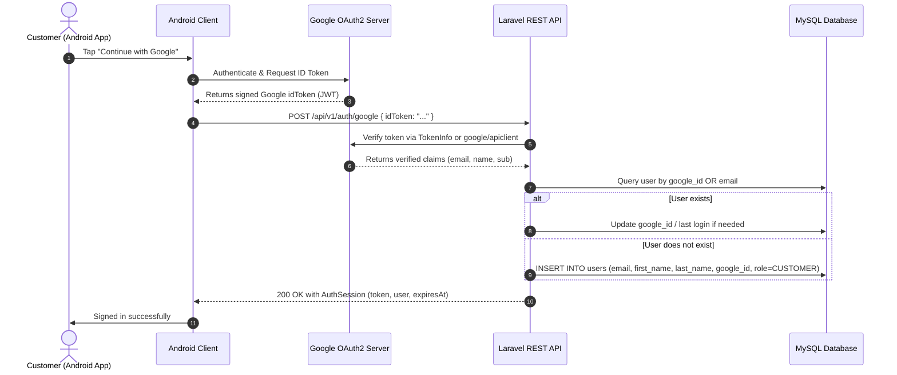

# Implementation Plan: BACKEND-GOOGLE-AUTH-INTEGRATION — Google Authentication REST API

## Overview
This plan specifies the backend implementation for Google Sign-In / Sign-Up ("Continue with Google") in the Laravel/PHP REST API.
It allows Android (and future web/admin clients) to submit a Google `idToken`, which is securely validated on the server. If verified, the backend logs in or registers the user in MySQL and issues our standard JWT session token.

---

## Architecture & Authentication Flow



---

## 1. Database Schema Updates
- **Migration:** `add_google_id_to_users_table.php`
  - Add nullable `google_id` (VARCHAR(255), unique index).
  - Modify `password` column to be nullable (as OAuth users do not authenticate with a traditional password).
  - Add index on `google_id` and `email` for rapid lookups.

---

## 2. API Contract Specification
- **Endpoint:** `POST /api/v1/auth/google`
- **Request Headers:**
  - `Content-Type: application/json`
  - `Accept: application/json`
- **Request Body:**
  ```json
  {
    "idToken": "eyJhbGciOiJSUzI1NiIsImtpZCI6..."
  }
  ```
- **Responses:**
  - **`200 OK` (Success):**
    ```json
    {
      "token": "1|laravel_sanctum_or_jwt_token_string",
      "user": {
        "id": 14,
        "email": "user@gmail.com",
        "firstName": "John",
        "lastName": "Doe",
        "role": "CUSTOMER"
      },
      "expiresAt": "2026-11-17T12:00:00Z"
    }
    ```
  - **`400 Bad Request`:** Missing or empty `idToken`.
  - **`401 Unauthorized`:** Token is invalid, expired, or audience does not match configured Google Client ID.

---

## 3. Files to Create / Modify

| Component | Path | Description |
| :--- | :--- | :--- |
| **Migration** | `backend/database/migrations/xxxx_xx_xx_add_google_id_to_users_table.php` | Adds `google_id` column and makes `password` nullable. |
| **Service** | `backend/app/Services/GoogleAuthService.php` | Validates Google ID token against Google OAuth endpoint / SDK. |
| **Controller** | `backend/app/Http/Controllers/Api/V1/GoogleAuthController.php` | Handles `POST /api/v1/auth/google`. |
| **Request** | `backend/app/Http/Requests/GoogleAuthRequest.php` | Validates presence and format of `idToken`. |
| **Route** | `backend/routes/api.php` | Registers `POST /auth/google`. |
| **Documentation** | `docs/API_CONTRACT.md` & `docs/openapi.yaml` | Documents new endpoint and schemas. |
| **Unit/Feature Tests**| `backend/tests/Feature/GoogleAuthTest.php` | Tests valid token, invalid token, account creation, account link. |

---

## 4. Implementation Steps

1. **Step 1: Database Migration**
   - Create migration to add `google_id` and allow null `password`.
   - Run `php artisan migrate`.
2. **Step 2: Google Token Verification Service**
   - Implement `GoogleAuthService` to verify token integrity, expiration, issuer (`accounts.google.com`), and audience (`GOOGLE_CLIENT_ID`).
   - Mock verification in testing environments.
3. **Step 3: Controller & Route Implementation**
   - Implement `GoogleAuthController@loginOrRegister`.
   - Issue Sanctum token and return standard `AuthSession` JSON payload.
4. **Step 4: API Contract & OpenAPI Documentation**
   - Add endpoint specs to `docs/API_CONTRACT.md` and `docs/openapi.yaml`.
5. **Step 5: Automated Testing**
   - Write feature tests in `tests/Feature/GoogleAuthTest.php` covering:
     - New user registration via Google ID Token.
     - Existing user login via Google ID Token.
     - Account linking (existing user by email without `google_id`).
     - Error handling for invalid/expired tokens.

---

## 5. Security & Verification Rules
- Always verify token signature against Google's public keys.
- Enforce audience check (`aud` claim must equal the configured Android/Web Google Client ID).
- Prevent privilege escalation: Google-created users must always be initialized with `role = CUSTOMER` (never `ADMIN`).
- Rate limiting: Apply `throttle:10,1` on `/api/v1/auth/google` to mitigate brute-force attacks.

---

## Implementation Notes (2026-10-19, owner-approved deviations)

Owner decisions recorded in the canonical task (Backend Roadmap — Phase 1 — Step 4, AUTH-004) supersede the plan where they differ:

1. **Sessions — Sanctum, not JWT:** the endpoint issues the same revocable Sanctum bearer session as password sign-in (ADR-007 / `docs/API_CONTRACT.md`). The plan's "JWT session token" wording is superseded.
2. **Contract-first:** `docs/openapi.yaml` was updated first (owner-approved) with `POST /auth/google` (`signInWithGoogle`), the `GoogleAuthRequest` schema, `GOOGLE_ACCOUNT_CONFLICT`, and the `google-login` rate class; the implementation follows it.
3. **Response/error semantics per contract:** `{data: AuthSession}` envelope; `201` when the account is created, `200` when it already exists; `422 VALIDATION_ERROR` for missing/oversized `idToken` (not `400`); `401 INVALID_CREDENTIALS` for invalid/expired/wrong-audience/unverified-email/suspended; `409 GOOGLE_ACCOUNT_CONFLICT` when the email is linked to a different Google subject; `500 INTERNAL_ERROR` fail-closed when `GOOGLE_CLIENT_ID` is unset or Google's keys are unavailable.
4. **No new dependency:** the ID token is verified locally with `openssl_verify` against Google's JWKS (`auth-google:jwks`, cached 3600s, one refetch on unknown `kid`) instead of `google/apiclient` or the TokenInfo endpoint.
5. **Paths in this repository:** the service lives at `backend/app/Services/GoogleAuthService.php`, the controller at `backend/app/Http/Controllers/GoogleAuthController.php` (no `Api/V1` subfolder), the request at `backend/app/Http/Requests/GoogleAuthRequest.php`; the shared session issuing was extracted to `backend/app/Services/AuthSessionIssuer.php` (used by AUTH-001 too); tests at `backend/tests/Feature/Auth/GoogleAuthTest.php` (hermetic via a local RSA key and a faked JWKS, no external calls).
6. **Only the Google subject is persisted** (`users.google_id`); the raw ID token is never stored or logged; `password` is nullable for Google-only accounts.

Verification (2026-10-19, owner-requested full recheck): `php artisan test` = 173 tests / 2202 assertions / 0 failures (16 in `tests/Feature/Auth/GoogleAuthTest.php`); `vendor/bin/pint --test` passed; migration up/down round-trip clean; `docs/openapi.yaml` Redocly lint = 0 errors / 2 accepted warnings. See Backend Roadmap — Phase 1 — Step 4 for the full record.
